# Ship hardpoints and mount specs

Generated by `art_src/sow/export.py` from the art itself; do not edit by hand. A labelled spec sheet image for every hull is in `docs/art/specs/`.

**Mount types:** `fixed` (gun or beam, fires along the heading), `turret` (rotating sprite on a ring), `launcher` (missile launcher). **Sizes:** `small`, `medium`, `large` — a weapon fits a mount of its size; large is reserved for future capital weapons.

| Mount | Size | Used for | Sprite |
|---|---|---|---|
| fixed gun | small | forward guns (SOW forward gun pair, pirate guns) | part of the hull |
| fixed beam | small | mining beam emitter | part of the hull |
| turret | small | light twin turret (TUR-1), point-defence turret (PD-1) | `parts/tur1.png`, `parts/pd1.png` |
| turret | medium | heavy twin turret (TUR-2) | `parts/tur2.png` |
| launcher | small | VLS-4 centre-strip launcher, 6 cells | part of the hull |
| launcher | medium | VLS-3 round-hatch launcher, 11 cells | part of the hull |

**Coordinates** are pixels from the sprite centre at 1:1 sprite scale: +x is starboard (right), +y is aft (down), the art faces up. Same convention as `hardpoints` in `data/README.md` (forward is negative y): once a sprite scale is chosen, multiply by it and copy the points into the ship JSON. `kind` uses the game names (`gun`, `turret`, `guided`, `beam`). `arc` is a suggestion; in the game a turret's arc comes from its weapon definition.

**Turrets:** hull sprites show an empty ring; the turret sprite's image centre is its pivot, barrels up at rotation 0. Previews with turrets fitted are in `sow/preview/`. **Engines** are nozzle exits for the glow effect.

## At a glance

| Hull | Size (px) | Mounts |
|---|---|---|
| SOW C-A Clamp courier (`sow_c_a_clamp`) | 48 × 103 | none (unarmed) |
| SOW C-B Booster courier (`sow_c_b_booster`) | 74 × 94 | none (unarmed) |
| SOW C-C Long-hauler (`sow_c_c_longhauler`) | 96 × 154 | none (unarmed) |
| SOW F-A Long-stack freighter (`sow_f_a_stack`) | 76 × 184 | 1× small turret |
| SOW F-B Container-spine freighter (`sow_f_b_spine`) | 65 × 217 | none (unarmed) |
| SOW F-C Wide-body freighter (`sow_f_c_widebody`) | 72 × 197 | 1× small turret |
| SOW K-A Boarding cutter (`sow_k_a_boarding`) | 48 × 143 | 1× small turret |
| SOW K-B Escort cutter (`sow_k_b_escort`) | 80 × 155 | 1× medium turret, 2× small point-defence turret, 1× small missile launcher |
| SOW P-A Picket corvette (`sow_p_a_picket`) | 48 × 99 | 2× small fixed gun, 1× small turret |
| SOW P-B Patrol corvette (`sow_p_b_patrol`) | 48 × 159 | 2× small turret, 1× small missile launcher |
| SOW R-A Gun cruiser (`sow_r_a_gun_cruiser`) | 94 × 189 | 2× small fixed gun, 2× medium turret, 2× small point-defence turret, 2× small turret |
| SOW R-B Missile cruiser (`sow_r_b_missile_cruiser`) | 96 × 222 | 1× medium turret, 2× small point-defence turret, 2× small turret, 2× medium missile launcher |
| SOW S-A Shuttle (`sow_s_a_shuttle`) | 48 × 119 | 1× small turret |
| Pirate raider (R-1C) (`pirate_raider`) | 62 × 128 | 1× small fixed beam, 2× small fixed gun |

## Standard Orbital Works

### SOW C-A Clamp courier — `sow_c_a_clamp`

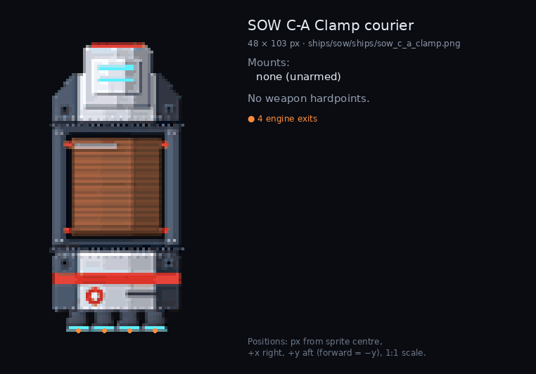

Sprite `ships/sow/ships/sow_c_a_clamp.png`, 48 × 103 px. **Mounts:** none (unarmed).

Engine exits: (-13.6, 51.2), (-4.5, 51.2), (4.5, 51.2), (13.6, 51.2)

### SOW C-B Booster courier — `sow_c_b_booster`

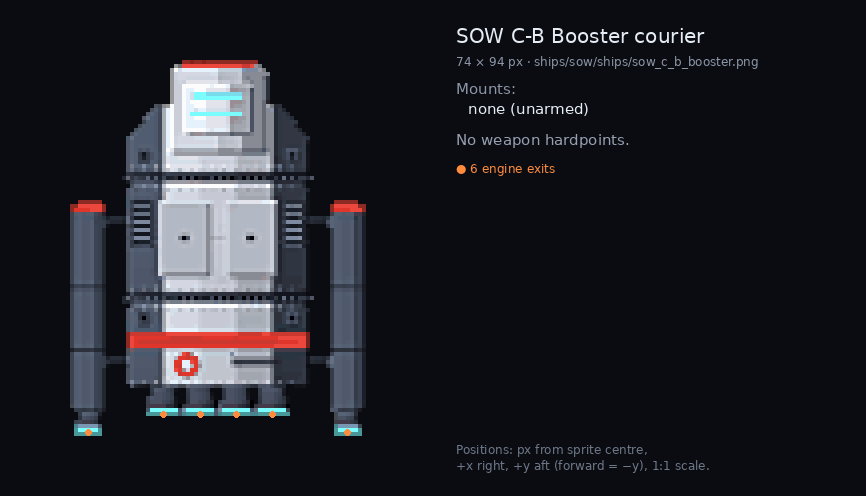

Sprite `ships/sow/ships/sow_c_b_booster.png`, 74 × 94 px. **Mounts:** none (unarmed).

Engine exits: (-32.4, 46.2), (-13.6, 41.7), (-4.5, 41.7), (4.5, 41.7), (13.6, 41.7), (32.4, 46.2)

### SOW C-C Long-hauler — `sow_c_c_longhauler`

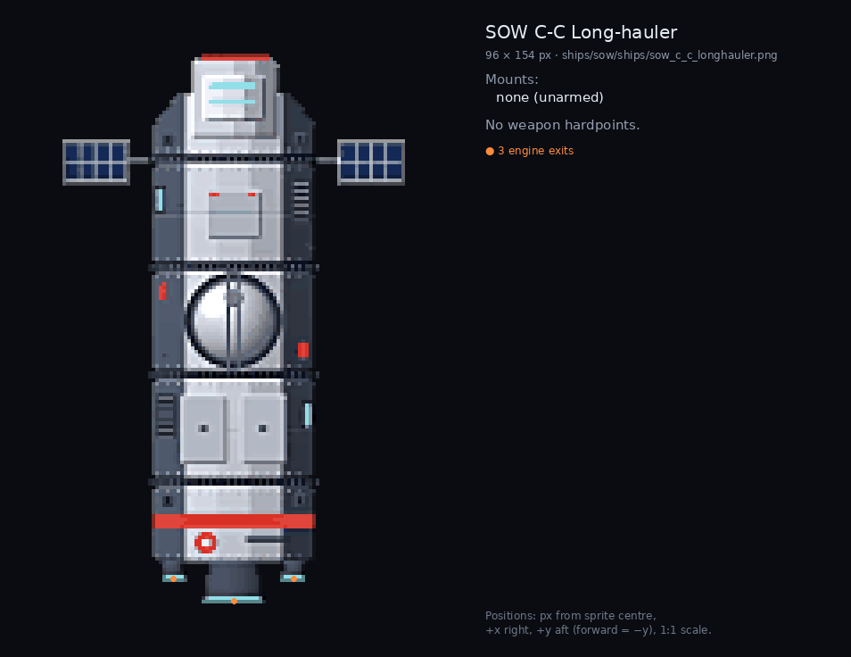

Sprite `ships/sow/ships/sow_c_c_longhauler.png`, 96 × 154 px. **Mounts:** none (unarmed).

Engine exits: (-16.8, 70.2), (0.0, 76.3), (16.8, 70.2)

### SOW F-A Long-stack freighter — `sow_f_a_stack`

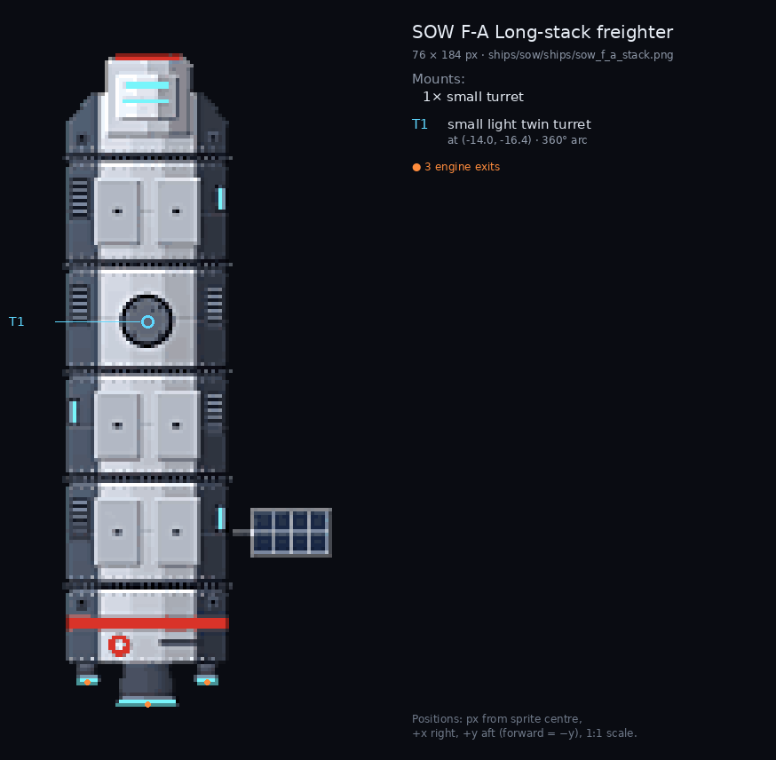

Sprite `ships/sow/ships/sow_f_a_stack.png`, 76 × 184 px. **Mounts:** 1× small turret.

| ID | Kind | Mount | Size | Role | Position (x, y) | Arc | Notes |
|---|---|---|---|---|---|---|---|
| T1 | `turret` | turret | small | light twin turret | (-14.0, -16.4) | 360° | ring centre = turret pivot; turret sprite barrels point up at rotation 0 |

Engine exits: (-30.8, 85.2), (-14.0, 91.4), (2.8, 85.2)

### SOW F-B Container-spine freighter — `sow_f_b_spine`

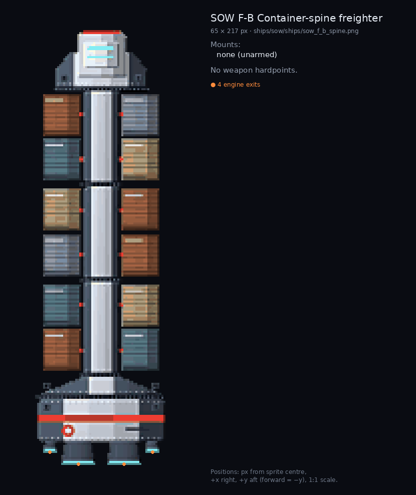

Sprite `ships/sow/ships/sow_f_b_spine.png`, 65 × 217 px. **Mounts:** none (unarmed).

Engine exits: (-25.1, 102.0), (-10.9, 108.1), (11.9, 108.1), (26.0, 102.0)

### SOW F-C Wide-body freighter — `sow_f_c_widebody`

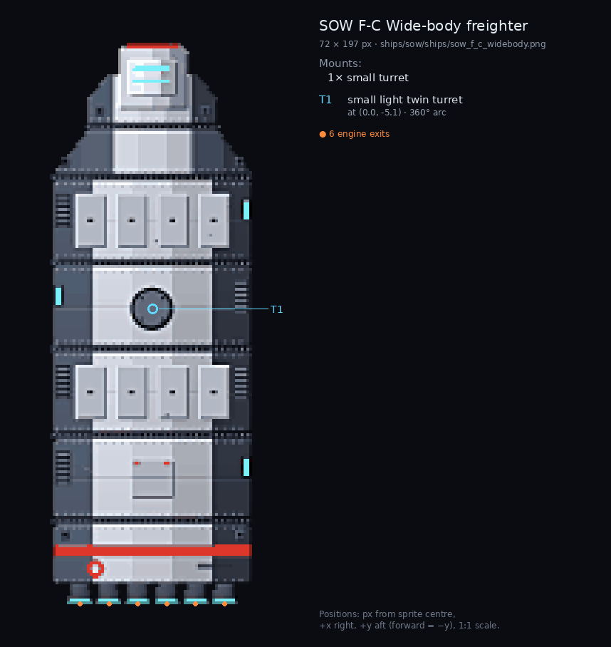

Sprite `ships/sow/ships/sow_f_c_widebody.png`, 72 × 197 px. **Mounts:** 1× small turret.

| ID | Kind | Mount | Size | Role | Position (x, y) | Arc | Notes |
|---|---|---|---|---|---|---|---|
| T1 | `turret` | turret | small | light twin turret | (0.0, -5.1) | 360° | ring centre = turret pivot; turret sprite barrels point up at rotation 0 |

Engine exits: (-25.4, 98.3), (-15.2, 98.3), (-5.1, 98.3), (5.1, 98.3), (15.2, 98.3), (25.4, 98.3)

### SOW K-A Boarding cutter — `sow_k_a_boarding`

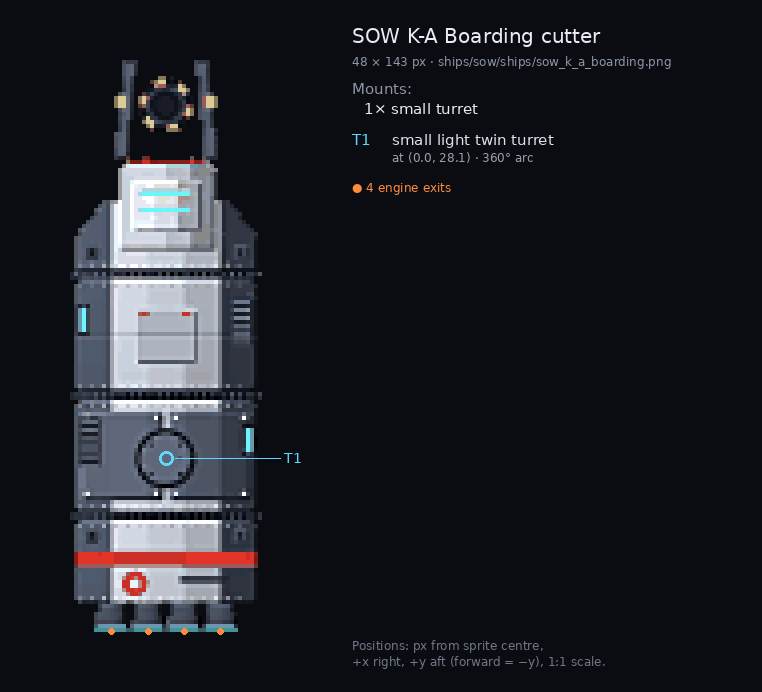

Sprite `ships/sow/ships/sow_k_a_boarding.png`, 48 × 143 px. **Mounts:** 1× small turret.

| ID | Kind | Mount | Size | Role | Position (x, y) | Arc | Notes |
|---|---|---|---|---|---|---|---|
| T1 | `turret` | turret | small | light twin turret | (0.0, 28.1) | 360° | ring centre = turret pivot; turret sprite barrels point up at rotation 0 |

Engine exits: (-13.6, 71.3), (-4.5, 71.3), (4.5, 71.3), (13.6, 71.3)

### SOW K-B Escort cutter — `sow_k_b_escort`

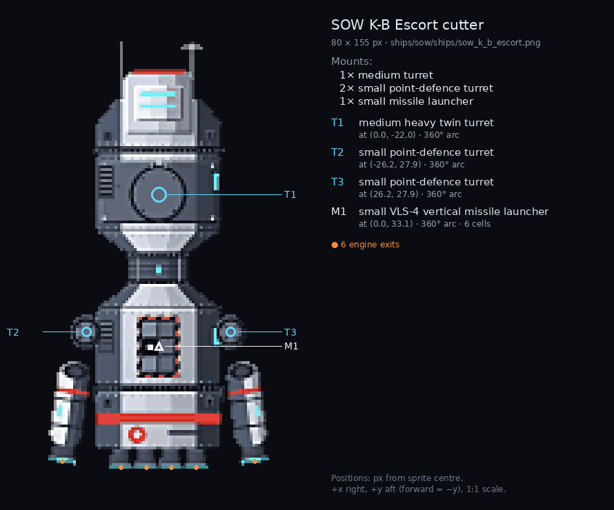

Sprite `ships/sow/ships/sow_k_b_escort.png`, 80 × 155 px. **Mounts:** 1× medium turret, 2× small point-defence turret, 1× small missile launcher.

| ID | Kind | Mount | Size | Role | Position (x, y) | Arc | Notes |
|---|---|---|---|---|---|---|---|
| T1 | `turret` | turret | medium | heavy twin turret | (0.0, -22.0) | 360° | ring centre = turret pivot; turret sprite barrels point up at rotation 0 |
| T2 | `turret` | turret | small | point-defence turret | (-26.2, 27.9) | 360° | ring centre = turret pivot; turret sprite barrels point up at rotation 0 |
| T3 | `turret` | turret | small | point-defence turret | (26.2, 27.9) | 360° | ring centre = turret pivot; turret sprite barrels point up at rotation 0 |
| M1 | `guided` | launcher | small | VLS-4 vertical missile launcher, 6 cells | (0.0, 33.1) | 360° | launcher centre; vertical launch, missiles turn onto any bearing |

Engine exits: (-34.9, 74.8), (-13.6, 77.2), (-4.5, 77.2), (4.5, 77.2), (13.6, 77.2), (34.9, 74.8)

### SOW P-A Picket corvette — `sow_p_a_picket`

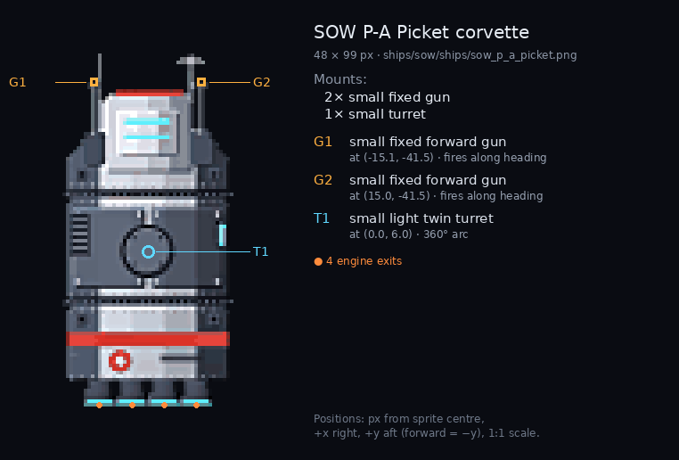

Sprite `ships/sow/ships/sow_p_a_picket.png`, 48 × 99 px. **Mounts:** 2× small fixed gun, 1× small turret.

| ID | Kind | Mount | Size | Role | Position (x, y) | Arc | Notes |
|---|---|---|---|---|---|---|---|
| G1 | `gun` | fixed | small | fixed forward gun | (-15.1, -41.5) | along heading | muzzle point; fires along the heading |
| G2 | `gun` | fixed | small | fixed forward gun | (15.0, -41.5) | along heading | muzzle point; fires along the heading |
| T1 | `turret` | turret | small | light twin turret | (0.0, 6.0) | 360° | ring centre = turret pivot; turret sprite barrels point up at rotation 0 |

Engine exits: (-13.6, 49.2), (-4.5, 49.2), (4.5, 49.2), (13.6, 49.2)

### SOW P-B Patrol corvette — `sow_p_b_patrol`

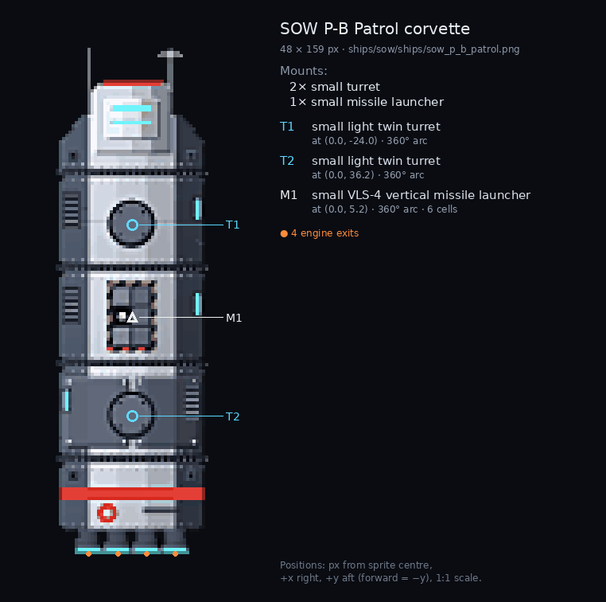

Sprite `ships/sow/ships/sow_p_b_patrol.png`, 48 × 159 px. **Mounts:** 2× small turret, 1× small missile launcher.

| ID | Kind | Mount | Size | Role | Position (x, y) | Arc | Notes |
|---|---|---|---|---|---|---|---|
| T1 | `turret` | turret | small | light twin turret | (0.0, -24.0) | 360° | ring centre = turret pivot; turret sprite barrels point up at rotation 0 |
| T2 | `turret` | turret | small | light twin turret | (0.0, 36.2) | 360° | ring centre = turret pivot; turret sprite barrels point up at rotation 0 |
| M1 | `guided` | launcher | small | VLS-4 vertical missile launcher, 6 cells | (0.0, 5.2) | 360° | launcher centre; vertical launch, missiles turn onto any bearing |

Engine exits: (-13.6, 79.4), (-4.5, 79.4), (4.5, 79.4), (13.6, 79.4)

### SOW R-A Gun cruiser — `sow_r_a_gun_cruiser`

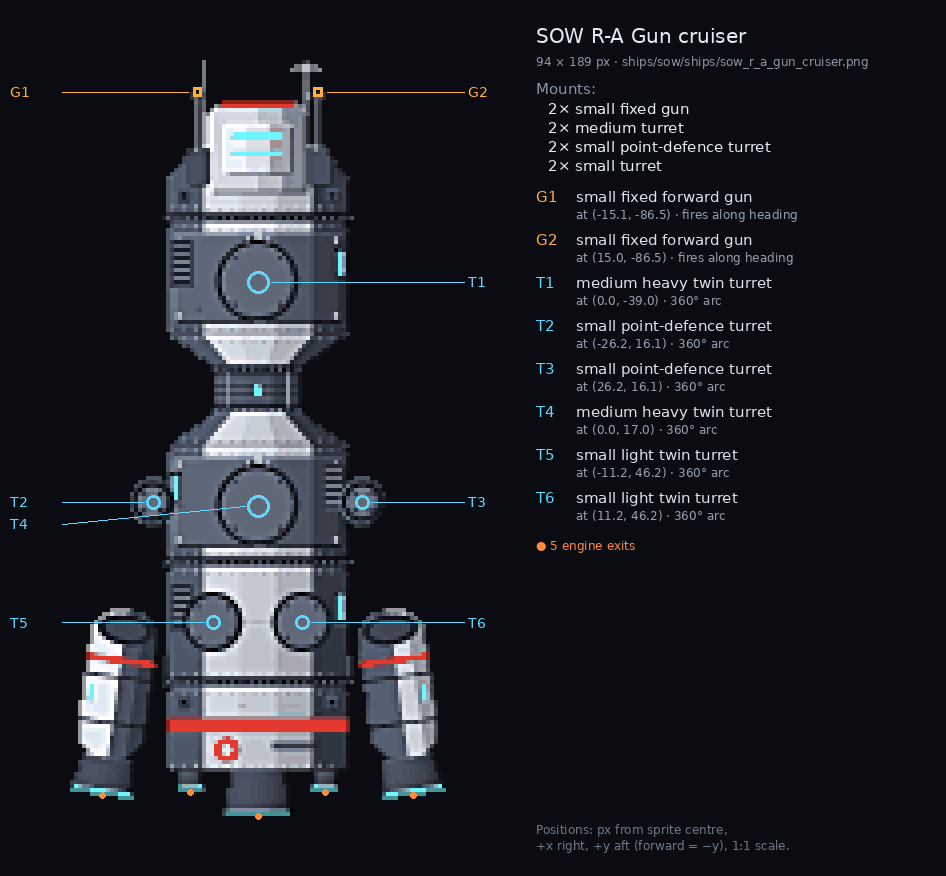

Sprite `ships/sow/ships/sow_r_a_gun_cruiser.png`, 94 × 189 px. **Mounts:** 2× small fixed gun, 2× medium turret, 2× small point-defence turret, 2× small turret.

| ID | Kind | Mount | Size | Role | Position (x, y) | Arc | Notes |
|---|---|---|---|---|---|---|---|
| G1 | `gun` | fixed | small | fixed forward gun | (-15.1, -86.5) | along heading | muzzle point; fires along the heading |
| G2 | `gun` | fixed | small | fixed forward gun | (15.0, -86.5) | along heading | muzzle point; fires along the heading |
| T1 | `turret` | turret | medium | heavy twin turret | (0.0, -39.0) | 360° | ring centre = turret pivot; turret sprite barrels point up at rotation 0 |
| T2 | `turret` | turret | small | point-defence turret | (-26.2, 16.1) | 360° | ring centre = turret pivot; turret sprite barrels point up at rotation 0 |
| T3 | `turret` | turret | small | point-defence turret | (26.2, 16.1) | 360° | ring centre = turret pivot; turret sprite barrels point up at rotation 0 |
| T4 | `turret` | turret | medium | heavy twin turret | (0.0, 17.0) | 360° | ring centre = turret pivot; turret sprite barrels point up at rotation 0 |
| T5 | `turret` | turret | small | light twin turret | (-11.2, 46.2) | 360° | ring centre = turret pivot; turret sprite barrels point up at rotation 0 |
| T6 | `turret` | turret | small | light twin turret | (11.2, 46.2) | 360° | ring centre = turret pivot; turret sprite barrels point up at rotation 0 |

Engine exits: (-38.9, 89.3), (-16.8, 88.5), (0.0, 94.7), (16.8, 88.5), (38.9, 89.3)

### SOW R-B Missile cruiser — `sow_r_b_missile_cruiser`

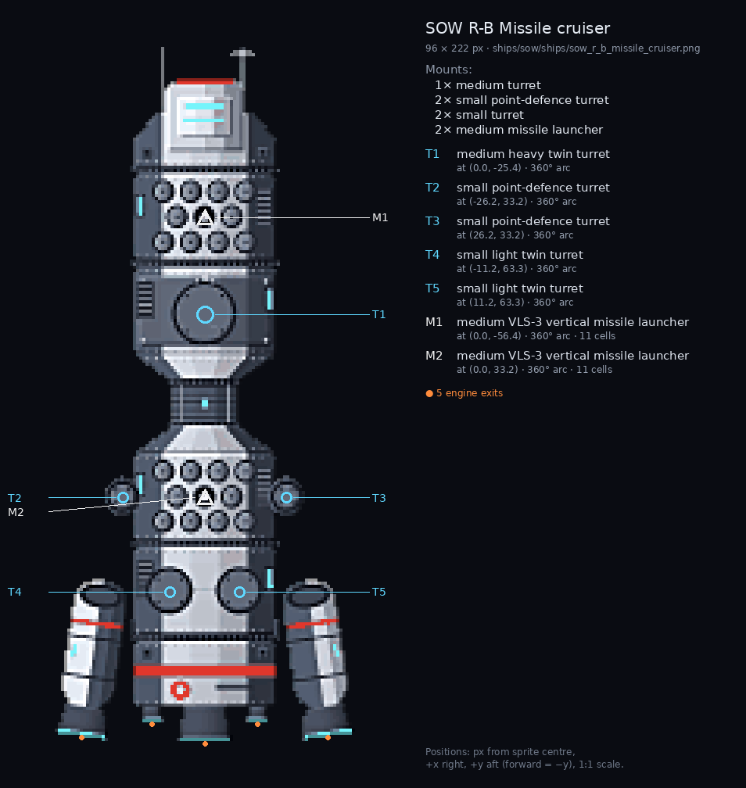

Sprite `ships/sow/ships/sow_r_b_missile_cruiser.png`, 96 × 222 px. **Mounts:** 1× medium turret, 2× small point-defence turret, 2× small turret, 2× medium missile launcher.

| ID | Kind | Mount | Size | Role | Position (x, y) | Arc | Notes |
|---|---|---|---|---|---|---|---|
| T1 | `turret` | turret | medium | heavy twin turret | (0.0, -25.4) | 360° | ring centre = turret pivot; turret sprite barrels point up at rotation 0 |
| T2 | `turret` | turret | small | point-defence turret | (-26.2, 33.2) | 360° | ring centre = turret pivot; turret sprite barrels point up at rotation 0 |
| T3 | `turret` | turret | small | point-defence turret | (26.2, 33.2) | 360° | ring centre = turret pivot; turret sprite barrels point up at rotation 0 |
| T4 | `turret` | turret | small | light twin turret | (-11.2, 63.3) | 360° | ring centre = turret pivot; turret sprite barrels point up at rotation 0 |
| T5 | `turret` | turret | small | light twin turret | (11.2, 63.3) | 360° | ring centre = turret pivot; turret sprite barrels point up at rotation 0 |
| M1 | `guided` | launcher | medium | VLS-3 vertical missile launcher, 11 cells | (0.0, -56.4) | 360° | launcher centre; vertical launch, missiles turn onto any bearing |
| M2 | `guided` | launcher | medium | VLS-3 vertical missile launcher, 11 cells | (0.0, 33.2) | 360° | launcher centre; vertical launch, missiles turn onto any bearing |

Engine exits: (-39.4, 109.9), (-16.8, 105.7), (0.0, 111.8), (16.8, 105.7), (39.4, 109.9)

### SOW S-A Shuttle — `sow_s_a_shuttle`

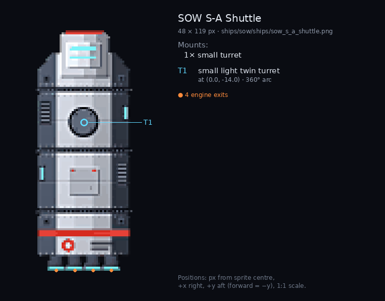

Sprite `ships/sow/ships/sow_s_a_shuttle.png`, 48 × 119 px. **Mounts:** 1× small turret.

| ID | Kind | Mount | Size | Role | Position (x, y) | Arc | Notes |
|---|---|---|---|---|---|---|---|
| T1 | `turret` | turret | small | light twin turret | (0.0, -14.0) | 360° | ring centre = turret pivot; turret sprite barrels point up at rotation 0 |

Engine exits: (-13.6, 59.3), (-4.5, 59.3), (4.5, 59.3), (13.6, 59.3)

## Pirates

### Pirate raider (R-1C) — `pirate_raider`

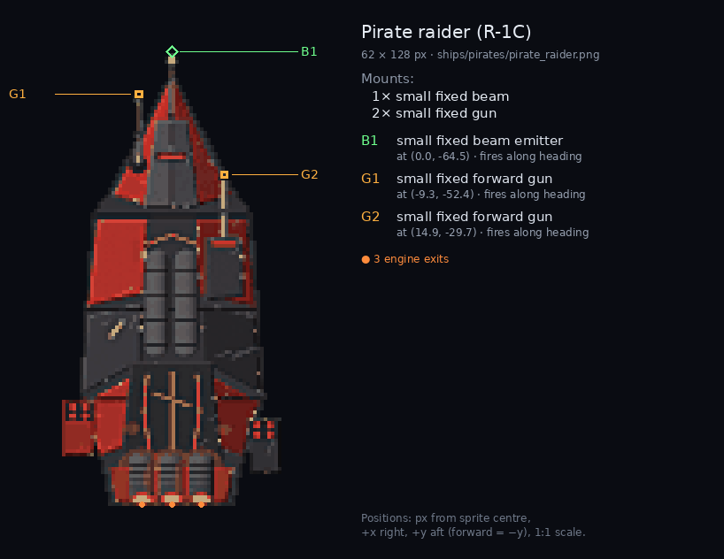

Sprite `ships/pirates/pirate_raider.png`, 62 × 128 px. **Mounts:** 1× small fixed beam, 2× small fixed gun.

| ID | Kind | Mount | Size | Role | Position (x, y) | Arc | Notes |
|---|---|---|---|---|---|---|---|
| B1 | `beam` | fixed | small | fixed beam emitter | (0.0, -64.5) | along heading | emitter tip; fires along the heading |
| G1 | `gun` | fixed | small | fixed forward gun | (-9.3, -52.4) | along heading | muzzle point; fires along the heading |
| G2 | `gun` | fixed | small | fixed forward gun | (14.9, -29.7) | along heading | muzzle point; fires along the heading |

Engine exits: (-8.4, 63.6), (0.0, 63.6), (8.4, 63.6)
