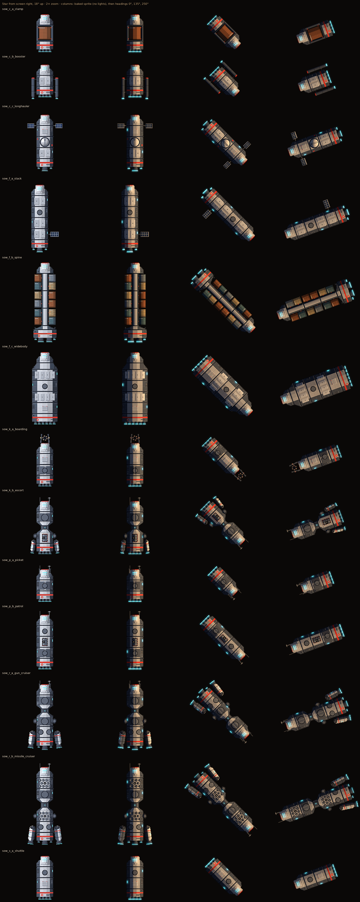

# Lit sprites (Amber Glass) — light maps and how to wire them in

The ship art direction is **Amber Glass**: a dark scene where hulls are shaped by the system's star, weapon fire and their own lights. Sprites stay painted pixels at 1:1; the generator now also exports light maps so Godot's 2D lights can light them live. Decision logged in `docs/decisions.md` (2026-10-30, Art direction "Amber Glass").

`docs/art/lighting/sow_lit.png` is a reference render (Python, same maths as Godot's 2D lights): first column is the baked sprite, then the hull at three headings with the star fixed at screen right. The lit flank stays on the star side whichever way the ship faces.

## What the generator writes

For every hull in `assets/sprites/ships/sow/ships/` and every part in `.../sow/parts/` (turrets and rings included):

| File | What it is |
|---|---|
| `<name>.png` | Unchanged baked sprite (light painted in from the top-left). Keep using it until lighting is wired in. |
| `<name>_albedo.png` | Colours with the baked shading removed. Same size, palette, alpha and dark rim pixel as `<name>.png`. |
| `<name>_n.png` | Normal map. RGB = XYZ × 0.5 + 0.5; +X right, +Y **up the image**, +Z towards the viewer (OpenGL convention, which Godot expects). Flat = (128, 128, 255). |
| `<name>_e.png` | Emission: bridge glass, light strips, engine exits in their own colour; black where nothing glows. |

All four images of a sprite are the same size and line up pixel for pixel, so hardpoint offsets, hit shapes and turret pivots are shared. Turret parts keep the full canvas (image centre = pivot), like their sprites. Pirate art does not have light maps yet (see Gaps).

## Wiring it in Godot (suggested)

1. **Ship texture.** Give each hull `Sprite2D` (and each turret) a `CanvasTexture` with `diffuse_texture = <name>_albedo.png` and `normal_texture = <name>_n.png`, texture filter Nearest. Godot rotates the normals with the node, so turning ships and turrets need nothing extra. Leave the default import settings (lossless, no "normal map" compression flag, invert-Y off).
2. **The star.** One `DirectionalLight2D` per system: amber-white colour, rotated so it comes from the star's direction on screen, `height` around 0.3 (a low star, about 18° up, gives the strong side-lit look; raise it towards 1 for flatter, softer light). Per the hard rules these values belong in system data (for example a `star` block with colour, energy, direction and height, with documented defaults in `data/README.md`), not in code.
3. **Ambient.** A dark, slightly cool `CanvasModulate` (around `#4b5161`) so the shadowed side keeps its silhouette. Put the HUD on its own `CanvasLayer` so it isn't darkened or lit.
4. **Weapon and engine light.** Short-lived `PointLight2D`s for muzzle flashes, laser bolts and impacts (warm colour, small radius, `height` ~20–30 px so they light the near flank). Engines can carry a dim permanent one at each engine exit from `hardpoints.json`.
5. **Emission.** Godot 2D lighting has no emission slot. Add a child `Sprite2D` with `<name>_e.png`, a `CanvasItemMaterial` with blend mode Add and light mode Unshaded. Optional bloom: enable `rendering/viewport/hdr_2d` and a `WorldEnvironment` with glow.
6. **What not to light.** Use light masks so the backdrop, starfield and HUD ignore the ship lights (scenery like asteroids can opt in later if it gets maps too).
7. **Quick check.** Put the star at screen top with the ship facing up: the bow's forward edges and the top-facing bevels should brighten. If the lighting looks upside down, the green channel is being read the other way: flip it with the import option `process/normal_map_invert_y` and tell art.

Reference values used for the preview: star colour (1.0, 0.62, 0.28), 18° elevation, ambient 0.12 with a cool tint. Godot's energy scale differs, so tune by eye in a test system.

When the hull manifest (`hull.json`, OF7, Phase 2 milestone 6) is built, it should list the albedo, normal and emission paths alongside the sprite layer.

## Painting new parts

- `p.facet(x0, x1, n)` and `p.edges(m)` already feed the normal map; `p.glow(m, col)` feeds the emission map.
- Any hand-written shading factor goes through `p.lit(f, nx, ny=None, flat=0.86)`: it returns `f` unchanged for the baked sprite and records the surface direction (`nx` across, `ny` down the canvas, −1..1) for the light maps. Collars, nozzles, tapers, nacelles and the fuel sphere use it.
- Fills with no shape information (bands, emblems, grilles, decals) keep the surface they sit on.
- `python art_src/sow/preview_lit.py` regenerates the reference sheet.

## Gaps

- **Pirate raider:** its painter bakes light per armour plate and paints its hot engines as plain colour, so it has no light maps yet. Needs the same treatment (plate facing → normal, hot parts → `glow`) in a follow-up art pass.
- **Solar panels** keep a small baked gradient in the albedo.
- Baked sprites (`<name>.png`) stay until the game has switched over; they can be dropped from export afterwards.
