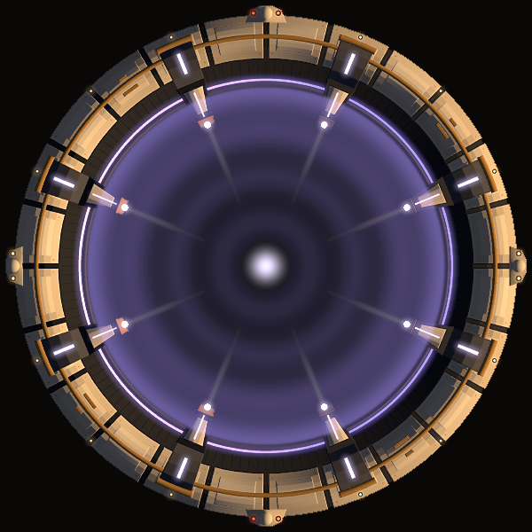

# Stellars: gates, stations, planets, the star and scenery (first pass)

First-pass production art for Phase 2 milestone 2 (V9): one hyperspace gate and one station per owner. Jarrad has signed these off as stand-ins; more iterations will follow (the gate especially, which is expected to become more complex and animated later). Concepts and the picks are in `docs/art/concepts/` and on the claude.ai design canvas "Terminal Velocity Gates and Stations Concepts".

| Asset | Sprite | Size at 1:1 | Data radius | Owner |
|---|---|---|---|---|
| Gate, Halo | `stellars/gates/gate_halo.png` | 600 × 600 | 300 | consortium-built; whoever controls the system operates it |
| Authority station, Ring | `stellars/stations/station_authority_ring.png` | 480 × 480 | 240 | local authority (Standard Orbital Works build) |
| Trader station, Container yard | `stellars/stations/station_trader_yard.png` | 480 × 480 | 240 | independent traders |
| Pirate station, Hollowed rock | `stellars/stations/station_pirate_rock.png` | 480 × 480 | 240 | pirates |

Paths are under `assets/sprites/`. Each sprite's diameter is its stellar's data radius × 2, as the milestone 2 plan asked, so `sprite_scale` is 1 for all four.



## Files per asset

Same conventions as `docs/art/lighting.md`; every image is the same size and pixel-aligned, and **the image centre is the stellar's centre** (canvases are never cropped).

| File | What it is |
|---|---|
| `<name>.png` | Baked sprite, light from the top-left (unlit fallback). |
| `<name>_albedo.png` | Colours without baked shading. |
| `<name>_n.png` | Normal map (+X right, +Y up the image, +Z towards the viewer; flat = 128, 128, 255). |
| `<name>_e.png` | Always-on emission: beacons, windows, light strips, hot vents (and their heat on the rock). |
| `<name>_e_ring.png` | **Gates only.** The ring emitters and the aperture field. Hide this layer to close the gate; the beacons in `_e` stay lit. The field has no hull under it, so this image has alpha where `_albedo` doesn't; draw it additive and unshaded like `_e`. |
| `<name>.json` | Manifest: `id`, `name`, `size_px`, `sprite_scale`, `hardpoints`, and for gates `jump_point`. |

## Anchors and hardpoints

Positions are pixels from the sprite centre at 1:1 (× `sprite_scale`): +x right, +y down the image, same as ship hardpoints.

- **Gate `jump_point`:** `[0, 0]`, the centre of the field.
- **Station hardpoints** use the ship format (`id`, `size`, `mount`, `pos`, optional `role: "point_defence"`). Station sprites show **empty turret rings**; turrets are the existing SOW turret sprites (`ships/sow/parts/tur1.png` small, `tur2.png` medium, `pd1.png` point defence), image centre = pivot, barrels up at rotation 0. The review sheets fit them facing outwards.

| Station | Mounts |
|---|---|
| Authority ring | T1–T4 small turrets on the ring, T5–T6 medium on the hub, T7–T10 small point defence on the rim |
| Container yard | T1–T2 small turrets on the spine |
| Hollowed rock | T1 medium, T2–T4 small, on bolted plating |

## For the code session

- **Station weapons need a requirement.** The art carries mounts, but stations can't fire yet and nothing in the Phase 2 spec asks them to. The architecture note (WeaponMounts and Health reused for station turrets) is the natural route.
- **Hardpoint editor:** it can open these sprites, but it has no named anchor points (`jump_point`, future docking ports) and one hit capsule only; the yard and the rock would want compound shapes (OF7).
- **Manifests sit beside the sprites** in `assets/sprites/stellars/`. Godot will import the PNGs on the next run (no `.import` files committed with this branch).
- No large turret sprite exists yet; none of these stations uses a large mount.
- Pirates use SOW turrets for now; a pirate turret style is a later art task.

## Review sheets

`docs/art/stellars/`: `<name>_lit.png` (star from screen right, 18° up, turrets fitted), `_lit_sw.png` (star from the lower left), `_lit_2x.png` (2× detail), `gate_halo_closed.png`, and for stations `_rings.png` (empty rings) and `_hardpoints.png` (mounts labelled; point defence in amber).

## Regenerating

Generated, not hand-edited. Sources are in `art_src/stellar/`: `prod.py` (the production painters), `skit.py` (radial shapes, the ring emission channel, light maps on top of the SOW painter), `export.py`.

```
python art_src/stellar/export.py all                 # everything, production quality (about 30 minutes)
python art_src/stellar/export.py station_pirate_rock  # one asset
python art_src/stellar/export.py gate_halo --ss 4     # quick draft (overwrites the committed files)
```

Concepts: `python art_src/stellar/concepts.py gates|stations` writes `docs/art/concepts/`.

## Planets, star, scenery and map icons (first pass)

Also stand-ins, signed off by Jarrad for now; another pass will follow. Review sheets: `docs/art/stellars/planets_lit.png`, `star_tints.png`, `scenery_lit.png`, `icons.png`.

### Planets (`stellars/planets/`)

Eight types, one sprite set each, reusable for any planet of that type: `planet_terran`, `planet_ocean`, `planet_desert`, `planet_ice`, `planet_volcanic`, `planet_barren`, `planet_rust`, `planet_gas_giant`.

- **Canvas 1024 px, disc 900 px** (room round the disc for the atmosphere). Scale per stellar: `sprite_scale = radius * 2 / 900` (Meridian, radius 600: 1.33; Tethys, 1200: 2.67). Use Linear texture filtering for planets, since they are scaled up.
- **No baked terminator.** The normal map is the sphere plus surface relief, so the lit side faces the system's star wherever the planet sits.
- **Layers**, all on the 1024 canvas and centred, drawn in this order:
  1. `_rings` + `_rings_n` (gas giant only; its own 1900 px canvas, same centre) under the planet, lit.
  2. `_albedo` + `_n` the surface, lit.
  3. `_e` emission (city lights on terran, ocean and rust; lava on volcanic), additive and unshaded. City lights currently show on the day side too; masking them to the dark side needs a small shader.
  4. `_clouds` + `_clouds_n`, lit; can turn slowly as a separate node.
  5. `_atmo` + `_atmo_n`, the atmosphere rim, additive and lit.
- `<planet>.png` is the baked fallback (all layers, light from the top-left). `<planet>.json` lists the layers, `disc_px` and, for rings, `rings_px`.
- The barren moon has no clouds or atmosphere; desert and ice have no emission.

### Star (`stellars/stars/`)

`star_e.png`: one greyscale star, emission only (granulation, limb darkening, corona). **Canvas 1024 px, disc 460 px**: `sprite_scale = radius * 2 / 460`. Modulate by the star's data `colour` and draw additive; it is not lit by anything. No albedo or normal map.

### Scenery (`stellars/scenery/`)

Each sprite has `_albedo`, `_n`, `_e` and the baked `.png`, cropped square with the object centred (scenery spins about its centre). The game scales a scenery sprite so its largest side equals the object's size, so each is drawn at the top of its range and only ever scales down.

| Set | Files | Drawn at | Fits scenery type |
|---|---|---|---|
| Large asteroids | `asteroid_large_rock_1..4`, `asteroid_large_ice_1..3`, `asteroid_large_metal_1..3` | ~180 px | `large_asteroid` (90–180) |
| Rocks | `asteroid_rock_1..6`, `asteroid_rock_ice_1..4`, `asteroid_rock_metal_1..4` | ~48 px | `rock` (20–45) |
| Rock debris | `debris_rock_1..6` | ~12 px | `small_debris` (5–12) |
| Wreck metal | `debris_metal_1..6` | ~16 px | wreck fragments (a new debris type, or mixed into `small_debris`) |
| Wreck sections | `wreck_sow_bow`, `wreck_sow_mid`, `wreck_sow_aft`, `wreck_sow_split` | up to ~110 px | `derelict_hull` (50–110) |
| Nav buoys | `buoy_authority`, `buoy_gate` | 36 px | new scenery or system objects; their lights are in `_e` |

Wreck sections are SOW hull modules torn across and scorched, lights dead. Ice and metal sets are new options for system data (for example an icy belt); nothing points at them yet.

### Map icons (`stellars/icons/`)

64 px icons for the galaxy map's system view (TR7): `icon_star` (greyscale, tint it), one per planet type, `icon_gate_halo` and one per station. Lit from the upper right, transparent background.

### Regenerating

```
python art_src/stellar/export_natural.py all        # planets, star, scenery, icons (about 8 minutes)
python art_src/stellar/export_natural.py planets planet_ice
python art_src/stellar/export_natural.py scenery
```

Sources: `natural.py` (planets and the star: 3D noise on the sphere, layers, lit preview), `scenery.py` (asteroids, debris, wrecks, buoys), `export_natural.py`. Icons are made from the planet, star, gate and station files, so export those first.
